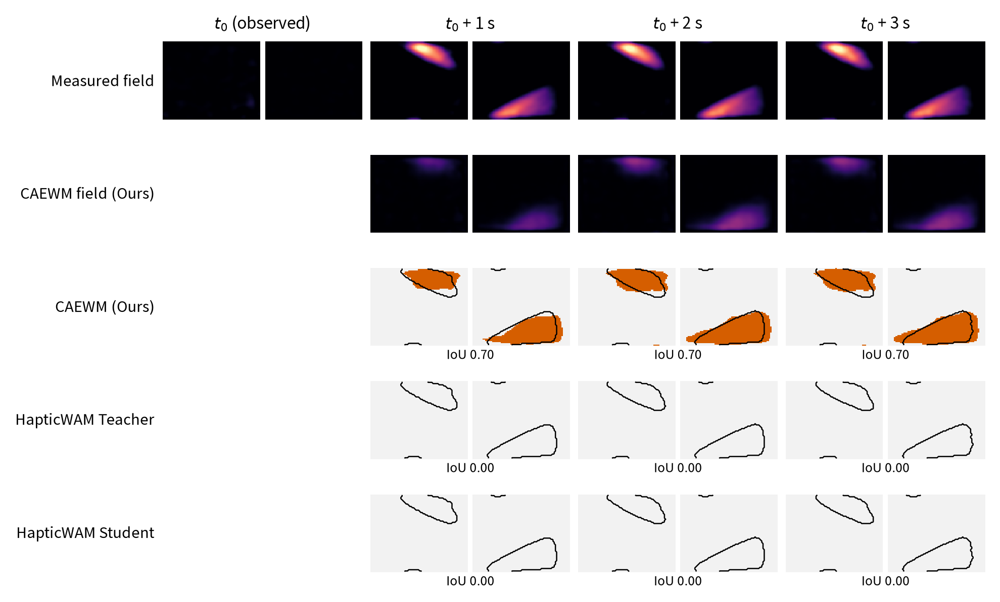
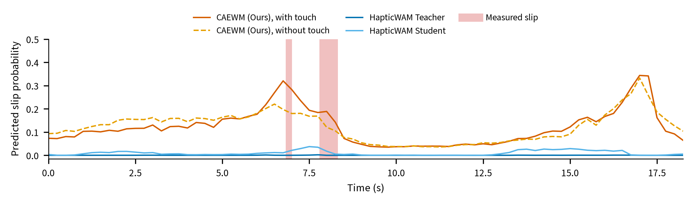

# CAEWM

CAEWM is a world-action model for contact-rich robot manipulation. From a single scene image, the robot state and, when a sensor is fitted, the recent history of two optical tactile fingertips, it jointly predicts the future video, the future deformation of both fingertip pads and the next chunk of end-effector actions. It is built on the frozen Cosmos-Predict2.5-2B video diffusion backbone and starts from the open-source HapticWAM code base, which serves as our baseline.

This repository holds the first version of the model (V1) and the code that trains and evaluates it. In short, one set of CAEWM weights predicts contact clearly better than every released HapticWAM model, both with and without tactile input, and it also produces sharper future frames, while its action accuracy is still behind the baseline. The sections below explain what we changed, what the experiments show, where V1 falls short and how to reproduce it.

## What CAEWM changes

CAEWM keeps the overall design of HapticWAM. The backbone is the frozen Cosmos-Predict2.5-2B. The current image, the robot state, the tactile observation, the future video, the future contact and the actions are laid out as frames of one sequence and generated jointly with rectified flow, and only low-rank adapters on the backbone and the newly added modules are trained. We changed three things, namely how touch enters and leaves the model, how vision and touch are aligned in space, and how the parts of the sequence are noised during training. We also added a readout for slip and contact. Every new module either sits outside the backbone or is inserted between blocks with zero-initialised output layers, so at the first training step the network is identical to the original backbone. CAEWM is trained once from the Cosmos base for 20,000 updates with the recipe of the HapticWAM v6 teacher, using demonstrations only.

The first change is the representation of touch. HapticWAM reads a single mechanical field at the current time, encodes the gel image with a video VAE that was trained on natural video, concatenates the two fingers, and predicts a hand-designed contact package that shares nothing with its input. We instead train a small causal tactile autoencoder of 9.8 M parameters on the training split and then freeze it. For one fingertip it reads the last four frames of the five informative field channels, which are the two in-plane displacement components, the indentation depth and the two shear components, together with the differences between consecutive frames. The three uncalibrated force channels are dropped. The encoder compresses this short history into a 16×8×10 latent, and the decoder reconstructs the current field and its change since the previous frame. The right pad is flipped vertically so that the same cell on both pads covers the same physical location, and the two latents are rewritten as a common part $c=\tfrac12(z^L+z^R)$ and a differential part $d=\tfrac12(z^L-z^R)$, which separate whether the object is held from whether the load is balanced between the fingers. The same latent space serves as input and as output. The input is the latent at $t_0-0.5$ s and at $t_0$, which replaces the gel frame and the single mechanical field. The output is the latent change at six future times

$$\delta_k=\frac{z(t_0+\tau_k)-z(t_0)}{\sigma_\Delta},\qquad \tau_k=0.5k,\quad k=1,\dots,6,$$

where $\sigma_\Delta$ is the standard deviation of latent changes on the training split. An output of zero means that the contact stays as it is, so the model only has to learn how it will change. The predicted change is added back to the current latent and decoded by the frozen decoder into full future deformation fields for both fingers. Contact masks, centres of pressure and slip scores then follow from the same rules HapticWAM uses, so the official scoring functions apply unchanged. The latents are upsampled by two and written losslessly into quarters of a backbone frame, which puts the tactile observation into one frame and the future touch into three.

The second change, GeoBridge, ties touch to the place in the image where the fingertips are. HapticWAM gives its tactile frames the same spatial position encoding as the image. This suggests a relation between a tactile cell and the image cell at the same position, which does not exist, and the model is never told where the fingertips appear in the image. We project the current tool centre point into the scene camera with the calibration that ships with the code and draw a Gaussian $G$ with a standard deviation of 1.5 tokens around it on the 16×20 token grid. After blocks 4, 10, 16 and 22 of the 28 backbone blocks, a bridge exchanges information in both directions. One direction fuses summaries of the four quadrants of the tactile observation frame into a vector $s$ and adds $G(i,j)\,s$ to every image token, so the tokens near the fingertips receive most of it. The other direction takes the $G$-weighted mean of the conditioning image tokens, which summarises the image around the fingertips, and adds its projection to every tactile token. Without a tactile sensor the model relies on this second path to infer touch from what it sees. Both output layers start at zero. The rotary position rows of the tactile frames are also shifted past the image rows, which removes the false spatial correspondence.

The third change is group-wise noise. The backbone lets each frame of the sequence carry its own noise level, and a frame at noise level zero acts as a condition. In HapticWAM the set of conditioning frames is fixed, and the model runs without touch only through a separately distilled student. In CAEWM the choice is drawn for every training sample. With Touch Forcing, the tactile observation frame is kept clean as a condition with probability 0.5, and otherwise it is generated together with the future at the same noise level and supervised with weight 0.5. One set of weights therefore reads the measured touch when a sensor is present and imagines the current touch from the image and the robot state when it is not, which removes the distillation stage and the student model. The input of the anticipatory contact coupling (ACC) becomes the mean and root mean square of the current tactile latent together with a flag for sensor presence, and this also removes the two-pass training of HapticWAM. With video decoupling, a sample keeps the tactile observation, the future touch and the future actions at their ground truth with probability 0.3 and noises only the future video, with only the video loss active, so the model learns how the scene changes for given actions and touch. The weight of the video loss is raised from 0.1 to 1.0. At deployment the model still runs a single joint denoising step. For visualisation, the actions and touch from that step are held fixed and the video alone is refined for 10 more steps.

Finally, a causal convolution over the six future slots reads slip and contact probabilities for each finger from the hidden states of the future-touch frames. Slip labels are derived at the native sensor rate, a slip counts only when two consecutive frames in contact exceed the slip threshold, and the slip loss is a focal loss computed on contact slots only. The whole model has about 57 M trainable parameters against 27.9 M for the HapticWAM teacher, and its sequence has 13 frames and 4,160 tokens against 14 frames and 4,480 tokens.

## Results

We compare CAEWM with the released HapticWAM checkpoints. The HapticWAM teacher is trained for 20,000 updates on demonstrations and then fine-tuned for 2,000 updates on simulation episodes and robot rollouts. We report both checkpoints, and the second one is the teacher deployed in the paper. The student is distilled from the deployed teacher and runs without tactile input. For video we also include the four arms of the HapticWAM world-model loss study. CAEWM is evaluated with the same weights in two settings, once with the measured fingertip fields as input and once with the current touch imagined by the model. All numbers use the same 248 validation windows ([configs/eval/windows_val124x2_seed7.json](configs/eval/windows_val124x2_seed7.json)) drawn from episodes that never enter training, with one denoising step, four seeds per window, EMA weights and no previously imagined contact package. Contact quantities are scored with the HapticWAM scoring functions at 1, 2 and 3 s after the anchor, after the decoded CAEWM fields have been converted into the same contact package. Models are grouped by whether tactile input is available at inference. Within each group the best entry is in bold and the second is underlined.

Table 1 covers the predicted contact. With tactile input CAEWM raises the contact mask IoU from 0.229 to 0.302, and it is the only model above the 0.243 obtained by keeping the current contact unchanged. Its lead grows with the prediction horizon, from 0.043 at 1 s to 0.091 at 3 s, while the deployed teacher falls from 0.204 to 0.158. Events are read from the event head of every model, because the packed event band of HapticWAM reaches an event accuracy below 0.09 on these windows. Without tactile input the HapticWAM student almost never predicts a contact region and detects few contact onsets, whereas CAEWM with imagined touch stays close to its own sensor setting on every event measure.

<p align="center"><b>Table 1.</b> Contact prediction on 248 validation windows, pooled over 1, 2 and 3 s.</p>

| Model | Mask IoU ↑ | CoP error ↓ | Event acc. ↑ | Contact-event F1 ↑ | Onset F1 ↑ | Onset error (ms) ↓ |
|:--|:--:|:--:|:--:|:--:|:--:|:--:|
| *With fingertip tactile input* | | | | | | |
| HapticWAM Teacher (before simulation fine-tuning) | <u>0.229</u> | <u>0.477</u> | <u>0.791</u> | <u>0.916</u> | <u>0.935</u> | <u>334</u> |
| HapticWAM Teacher | 0.181 | 0.531 | 0.654 | 0.778 | 0.663 | 502 |
| CAEWM (Ours) | **0.302** | **0.365** | **0.829** | **0.932** | **0.946** | **277** |
| *Without fingertip tactile input* | | | | | | |
| HapticWAM Student | <u>0.007</u> | <u>0.557</u> | <u>0.557</u> | <u>0.644</u> | <u>0.108</u> | <u>515</u> |
| CAEWM (Ours) | **0.180** | **0.436** | **0.821** | **0.934** | **0.935** | **302** |

Table 2 asks a simpler question for each window, whether either fingertip will slip within the next second. The label is a debounced slip, and 7.3% of the windows are positive. HapticWAM offers two slip probabilities, one from its ACC event distribution and one from its event head at 1 s, and each HapticWAM entry takes the better of the two so that the baseline is not understated. CAEWM is scored by the largest slip probability of its event head over the first two future slots and both fingers. It ranks slip windows better than every HapticWAM model in both settings.

<p align="center"><b>Table 2.</b> Slip anticipation within 1 s at window level.</p>

| Model | AUROC ↑ | AP ↑ |
|:--|:--:|:--:|
| *With fingertip tactile input* | | |
| HapticWAM Teacher (before simulation fine-tuning) | 0.763 | 0.204 |
| HapticWAM Teacher | <u>0.820</u> | <u>0.316</u> |
| CAEWM (Ours) | **0.884** | **0.412** |
| *Without fingertip tactile input* | | |
| HapticWAM Student | <u>0.753</u> | <u>0.170</u> |
| CAEWM (Ours) | **0.865** | **0.300** |

Table 3 compares the decoded future frames with the recorded frames at 1, 2 and 3 s, averaged over the three horizons, on the full image and on a 96×96 crop centred on the projected tool centre point where the gripper and the object are. None of the HapticWAM variants changes the picture much, and raising the video weight to 1.0 or enabling video attention in a 2,000-update fine-tune moves PSNR by less than 0.2 dB. With a single step CAEWM improves PSNR by 1.2 dB over the best HapticWAM variant and gives the highest SSIM, on the full frame and around the gripper. With 10 extra steps of video refinement it gives the lowest LPIPS on both.

<p align="center"><b>Table 3.</b> Future video prediction, averaged over 1, 2 and 3 s.</p>

| Model | Steps | PSNR ↑ | SSIM ↑ | LPIPS ↓ | Gripper PSNR ↑ | Gripper SSIM ↑ | Gripper LPIPS ↓ |
|:--|:--:|:--:|:--:|:--:|:--:|:--:|:--:|
| HapticWAM Teacher (before simulation fine-tuning) | 1 | 19.76 | 0.728 | 0.192 | 15.20 | 0.495 | 0.385 |
| HapticWAM Teacher (before simulation fine-tuning) | 5 | 19.43 | 0.748 | 0.160 | 14.72 | 0.507 | 0.318 |
| HapticWAM Teacher | 1 | 19.75 | 0.735 | 0.191 | 15.17 | 0.499 | 0.387 |
| HapticWAM Teacher, λ<sub>v</sub> = 1.0 | 1 | 19.94 | 0.741 | 0.188 | 15.27 | 0.504 | 0.392 |
| HapticWAM Teacher, fine-tuning control | 1 | 19.77 | 0.729 | 0.191 | 15.20 | 0.495 | 0.389 |
| HapticWAM Teacher, no video loss | 1 | 19.76 | 0.728 | 0.190 | 15.21 | 0.495 | 0.384 |
| HapticWAM Teacher, video attention | 1 | 19.61 | 0.729 | 0.200 | 15.00 | 0.494 | 0.402 |
| HapticWAM Student | 1 | 19.46 | 0.738 | 0.167 | 14.93 | 0.515 | <u>0.290</u> |
| CAEWM (Ours) | 1 | **21.18** | **0.798** | <u>0.145</u> | **16.15** | **0.550** | 0.345 |
| CAEWM (Ours), video refinement | 1 + 10 | <u>20.21</u> | <u>0.792</u> | **0.115** | <u>15.38</u> | <u>0.532</u> | **0.256** |

The figure below shows a contact onset on the whiteboard task. At the anchor time the fingertips have not yet touched the object. CAEWM places both contact patches at the right location and with the right shape one second ahead, while neither HapticWAM model predicts any contact. The first two rows show the indentation depth, measured and decoded from the CAEWM prediction, and the last three rows show contact masks with the measured contact region outlined in black. The example was selected because the difference is clear, so it is not an average case.

<p align="center"></p>

The next figure follows the validation recording of the egg task that contains the most measured slip, with the anchor moved along it every 0.25 s. The slip probability of CAEWM starts to rise about a second before the first measured slip, peaks just before it and drops once the slip is over, while the HapticWAM teacher stays below 0.01 and the student below 0.04 over the whole recording.

<p align="center"></p>

## Known limitations

The main weakness of V1 is action accuracy. The offline terminal endpoint probe of HapticWAM anchors each validation recording 1.6 s before the gripper first closes and measures how far the end of the predicted action chunk lands from where the demonstrator went. On this probe CAEWM reaches 30.37 mm with tactile input and 29.26 mm without it, against 20.04 mm for the HapticWAM teacher and 22.30 mm for the student, and it is even worse than the 28.23 mm of a policy that does not move. The median error is close to the baseline, and nearly the whole gap comes from the 13% of windows with errors above 60 mm, which the teacher keeps at 4%. These failures sit in the carton and waffles tasks and almost all follow one pattern. Before the gripper has closed, the model already lifts as if the object were held, by 100 to 190 mm, in the same direction for all four seeds. The error is the same with and without tactile input, so it comes from a wrong estimate of the grasp phase rather than from touch. We see three likely causes, none of which has been tested on its own yet. Video decoupling removes the action loss from 30% of the samples while the video weight rises tenfold, so actions receive less training signal. ACC now reads the current touch, which is always empty before the gripper closes, whereas HapticWAM fed it the model's own prediction of future contact. The future prediction of CAEWM also lacks the wrist wrench and the pad force, although the transfer of the object's weight to the wrist is the most direct sign that a grasp has succeeded.

<p align="center"><b>Table 4.</b> Terminal endpoint error in mm on 124 validation windows with four seeds and one step.</p>

| Model | Mean ↓ | Median ↓ | > 60 mm ↓ | Whiteboard ↓ | Waffles ↓ | Egg ↓ | Carton ↓ |
|:--|:--:|:--:|:--:|:--:|:--:|:--:|:--:|
| No motion | 28.23 | – | – | – | – | – | – |
| HapticWAM Teacher (before simulation fine-tuning) | **20.04** | **14.1** | **4%** | **15.7** | **20.1** | **5.2** | 38.6 |
| HapticWAM Student | 22.30 | 15.7 | 6% | 15.8 | 35.6 | 7.4 | **30.4** |
| CAEWM (Ours), with tactile input | 30.37 | 15.0 | 13% | 16.9 | 31.2 | 5.3 | 68.7 |
| CAEWM (Ours), without tactile input | 29.26 | 14.9 | 12% | 16.4 | 28.9 | 5.6 | 66.7 |

Several smaller weaknesses remain. With imagined touch the shape and location of the contact region are still poor, with a mask IoU of 0.180, and on the full-resolution fields the skill over persistence is negative at 0.5, 1 and 1.5 s and only turns positive from 2 s onwards. The ACC contact gate and closing veto are slightly weaker than those of the HapticWAM teacher before simulation fine-tuning, with an AUROC of 0.943 against 0.949 for the gate and 0.884 against 0.904 for the veto, which matters because these signals control gripper closure at deployment. One-step predictions are close to a conditional mean, so decoded fields are too smooth and the indentation depth at a new contact is underestimated, and the future frames, although better than every HapticWAM variant, do not yet beat simply copying the current frame on SSIM and LPIPS. The model has twice the trainable parameters of the teacher, mostly in the four bridges, and it does not predict the normal force field or the wrist wrench.

A code review after training found two flaws in the V1 training step, both in [phantom/caewm/rf.py](phantom/caewm/rf.py). The event cross-entropy is not masked out on video-decoupled samples, so in about 30% of the samples the event head reads future-touch frames that hold the ground truth instead of a prediction. When the conditions are dropped for classifier-free training, which happens in 10% of the samples, the tactile observation is zeroed and still supervised, so the model is asked to reconstruct a mean latent there. Neither affects evaluation, since no condition is dropped and nothing is pinned at inference, but both should be fixed before the next model is trained from scratch. Finally, all results are offline. CAEWM has not been run on the robot, and the main claim of HapticWAM is closed-loop placement success. V1 is a single training run, so there is no estimate of the variance across training seeds.

## Repository layout

The CAEWM code lives next to the baseline code it builds on. The table lists the files that make up CAEWM and the tools that produce the numbers above. Everything else under `phantom/` is the shared infrastructure for data loading, the backbone, the training loop and the official scoring functions.

| Path | Contents |
|:--|:--|
| `phantom/model/tactile/tokenizer.py` | causal tactile autoencoder, mirroring and common and differential split |
| `phantom/train/pretrain_tactile_ae.py` | tokenizer training and export of latent statistics |
| `phantom/data/tactile_cache.py` | per-episode cache of the five field channels at 64×80 with native-rate contact and slip quantities |
| `phantom/caewm/build_latent_cache.py` | encodes every cached frame with the frozen tokenizer |
| `phantom/caewm/layout.py`, `packing.py` | 13-frame sequence layout and lossless packing of tactile latents into frames |
| `phantom/caewm/geometry.py`, `bridge.py` | tool centre point projection, Gaussian map and GeoBridge |
| `phantom/caewm/dit.py` | backbone wrapper with the bridges, shifted tactile position rows and the ACC visual summary |
| `phantom/caewm/rf.py` | rectified flow with Touch Forcing, video decoupling, losses and sampling in both modes |
| `phantom/caewm/heads.py` | slip and contact readout and the focal loss |
| `phantom/caewm/windows.py` | training windows with tactile latents, future targets, slip labels and the projected tool centre point |
| `phantom/caewm/config.py`, `builder.py`, `paths.py` | model configuration, model assembly and default locations |
| `tools/terminal_eval.py` | terminal endpoint probe, with `--touch sensor` or `--touch imagine` for CAEWM |
| `tools/cae_imagination_eval.py`, `tools/official_event_head_eval.py` | contact package and event metrics for CAEWM and for HapticWAM checkpoints |
| `tools/cae_tactile_eval.py`, `tools/slip_baseline_auroc.py`, `tools/official_head_slip_auroc.py` | full-resolution touch and slip anticipation |
| `tools/video_dump.py`, `tools/video_quality_score.py` | future frame export and PSNR, SSIM and LPIPS scoring |
| `tests/test_caewm.py` | packing round trip, layout, gradients, zero-initialised bridges and both sampling modes |

## Setup

We train and evaluate in a conda environment with Python 3.11 and PyTorch 2.13 for CUDA 12.9. The pinned packages are in `requirements/`, and the repository installs in editable mode on top of them. The Cosmos-Predict2.5 code is a git submodule and is imported as a library, not installed. LPIPS scoring needs `lpips` and `scikit-image`, which we keep in a separate environment.

```bash
git clone --recurse-submodules <this repository> caewm && cd caewm
pip install -r requirements/requirements-h100.txt   # or the file that matches your machine
pip install -e .
```

The backbone weights come from `nvidia/Cosmos-Predict2.5-2B` (only `robot/action-cond/` and `tokenizer.pth` are needed). The training data is the teleoperation dataset `armteam/hapticwam-teleop-dataset` with 1,115 episodes over four tasks. Unpack the eight task shards into `<data_root>/phantom-episodes/tasks`, unpack `batch_20260822.tar.zst` into a separate folder and link its 325 episodes into the task folders with `python tools/intake_recovery.py normalize <batch folder>` followed by `python tools/intake_recovery.py place <batch folder> <data_root>/phantom-episodes/tasks`, and extract `manifests_v6.tar` into `<data_root>/phantom-episodes`. The resulting `manifests/all.jsonl` must give 991 training and 124 validation episodes, which is the split the HapticWAM v6 teacher was trained on, and training should then log 7,928 windows. Copy `norm_stats.json` from the dataset and `text_embeddings.pt` from `armteam/hapticwam-teacher` into the task folder. The released HapticWAM checkpoints used for comparison are in `armteam/hapticwam-teacher`, `armteam/hapticwam-student` and `armteam/hapticwam-ablations`.

All locations are read from `configs/paths.yaml`, and per-machine values go into the gitignored `configs/paths.local.yaml`.

```yaml
cosmos_weights_root: /path/to/cosmos-predict2.5-2b
data_root: /path/to/data
runs_root: /path/to/caewm/runs
cosmos_text_embedding_cache: /path/to/data/phantom-episodes/tasks/text_embeddings.pt
```

From these values the code derives the episode folder `<data_root>/phantom-episodes/tasks`, the tactile caches `<runs_root>/../cache/tactile` and `<runs_root>/../cache/tactile_lat` and the tokenizer checkpoint `<runs_root>/tactile_ae/tactile_ae.pt` (see [phantom/caewm/paths.py](phantom/caewm/paths.py)). Every tool also accepts these locations as flags.

## Reproducing V1

The tactile tokenizer is trained before the world model, and its latents are cached once for every episode. The field cache holds the five channels of every episode at 64×80 and takes about 13 GB. Training the tokenizer for 30,000 steps takes under an hour on one L40S, and encoding the latents takes a few minutes. The tokenizer should reach a contact mask IoU of about 0.96 on the validation split, which the training log reports at the end.

```bash
export PYTHONPATH=$PWD
python -m phantom.data.tactile_cache
python -m phantom.train.pretrain_tactile_ae
python -m phantom.caewm.build_latent_cache --ae <runs_root>/tactile_ae/tactile_ae.pt
```

The world model is then trained for 20,000 updates with an effective batch of 8, here on two GPUs with gradient accumulation of 4 as set in `configs/compute.caewm.yaml`. All other settings match the HapticWAM v6 teacher. On two L40S cards the run took about 24.5 hours.

```bash
torchrun --standalone --nproc_per_node 2 -m phantom.train.train_teacher --arch caewm \
  --data <data_root>/phantom-episodes/tasks --hardware configs/hardware.nuc.yaml \
  --allow-config-drift --compute configs/compute.caewm.yaml --run-name caewm_v1 \
  --max-steps 20000 --ckpt-every 1000 --eval-every 1000 \
  --touch-forcing-p 0.5 --video-decouple-p 0.3 \
  --grasp-frac 0.3 --photo-aug 1.0 --wrench-baseline-rows 8 --cond-dropout 0.1 \
  --action-noise-per-strip --no-action-t-max-of-two \
  --lr 1e-4 --lr-new-modules 3e-4 --warmup-steps 500 --ema-decay 0.999 --device cuda
```

Every evaluation reads the EMA weights of the final checkpoint and runs on one GPU. The touch mode is chosen with `--touch sensor` or `--touch imagine`. The HapticWAM rows come from the same tools pointed at the released checkpoints, and `tools/haptic_imagination_eval.py` gives the official contact package scores for them.

```bash
CK=<runs_root>/teacher/caewm_v1/teacher_020000.pt
python tools/terminal_eval.py --ckpt $CK --data <data_root>/phantom-episodes/tasks \
  --hardware configs/hardware.nuc.yaml --split val --nfe 1 --seeds 4 --touch sensor --out terminal_sensor.json
python -m tools.cae_imagination_eval --ckpt $CK --touch sensor --out imagination_sensor.json
python -m tools.cae_tactile_eval --ckpt $CK --touch sensor --seeds 4 --out tactile_sensor
python tools/video_dump.py --ckpt $CK --nfe 1 --refine 10 --out video_refine10
python tools/video_quality_score.py video_refine10
python -m tools.official_event_head_eval --ckpt <hapticwam checkpoint> --out head.json
```

## License

This code is released under the Apache License 2.0 in [LICENSE](LICENSE). It is derived from the HapticWAM code base, which is distributed under the same license.
